

<a href="https://www.linkedin.com/in/matheus-pereira-lopes/"></a>

 

 

<picture>
  <source media="(prefers-color-scheme: dark)" srcset="assets/h-about-dark.svg">
  
</picture>

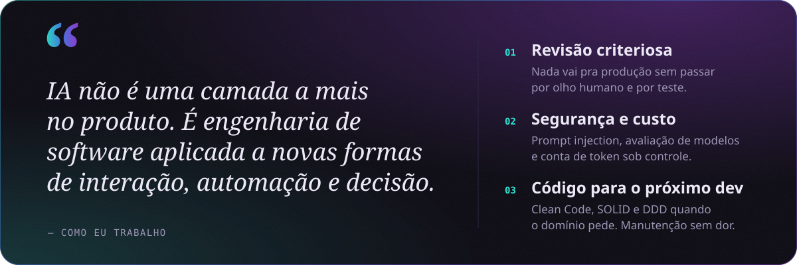

  

<picture>
  <source media="(prefers-color-scheme: dark)" srcset="assets/h-now-dark.svg">
  
</picture>


  

<picture>
  <source media="(prefers-color-scheme: dark)" srcset="assets/h-ailab-dark.svg">
  
</picture>



  

<picture>
  <source media="(prefers-color-scheme: dark)" srcset="assets/h-potinho-dark.svg">
  
</picture>

<a href="https://www.potinhodigital.com.br/"></a>


<a href="https://www.potinhodigital.com.br/"><b>Abrir o Potinho Digital ↗</b></a> · <a href="https://github.com/matheusplm/potinho-digital-front">código do front-end</a>

 

<picture>
  <source media="(prefers-color-scheme: dark)" srcset="assets/h-apotheosys-dark.svg">
  
</picture>

<a href="https://www.apotheosys.com.br/">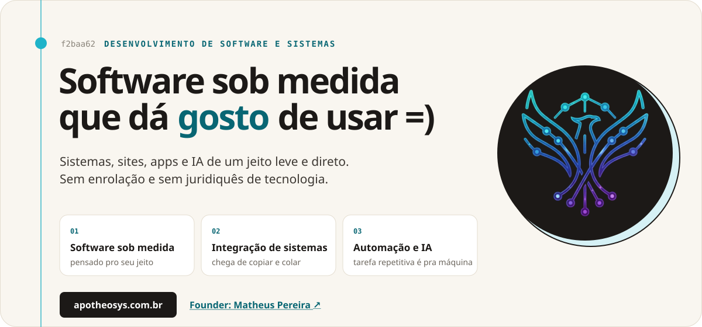</a>

  

<picture>
  <source media="(prefers-color-scheme: dark)" srcset="assets/h-work-dark.svg">
  
</picture>

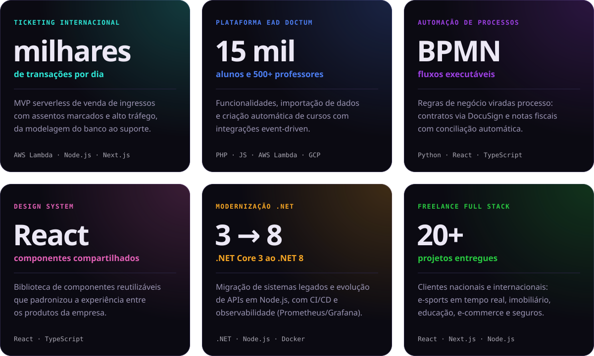

A maior parte dos projetos corporativos e de clientes é privada, então o código não está público.

<picture>
  <source media="(prefers-color-scheme: dark)" srcset="assets/h-stack-dark.svg">
  
</picture>

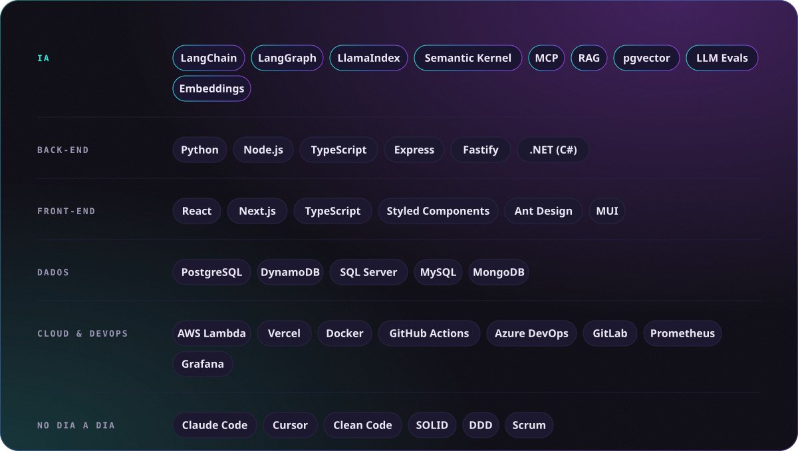

  

<picture>
  <source media="(prefers-color-scheme: dark)" srcset="assets/h-certs-dark.svg">
  
</picture>


  <a href="https://www.credly.com/badges/76f0e736-3b60-4261-a32a-0b0e9e62eaee">Verificar AWS Agentic AI</a> ·
  <a href="https://www.credly.com/badges/baecd58f-1958-4ce6-afa3-5aad7ea9b1d9">Verificar AWS Serverless</a> ·
  <a href="https://academy.claude.com/verify/9605b3fcaa37713fcd40fd810498bdee">Verificar Claude 101</a>

<picture>
  <source media="(prefers-color-scheme: dark)" srcset="assets/h-journey-dark.svg">
  
</picture>


  

<a href="https://www.linkedin.com/in/matheus-pereira-lopes/"></a>
